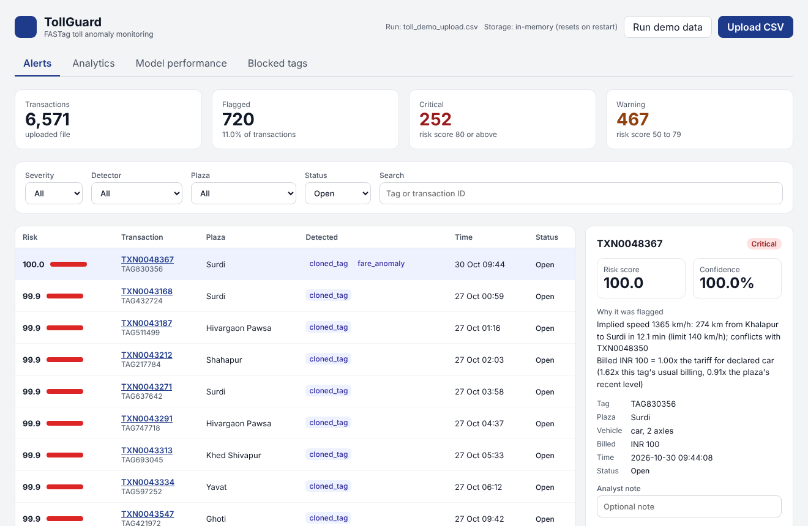

# TollGuard

## Overview

**Problem statement.** Electronic toll collection (FASTag) on Indian highways is exposed to fraud and abuse: cloned tags, vehicles billed at a lower class than they are, duplicate deductions, wrong fares, and request floods against plaza systems. Toll operators log millions of transactions and cannot review them by hand. TollGuard ingests toll-plaza transaction logs, detects these anomalies, gives each one a risk score and a plain-English reason, and lets an analyst confirm, dismiss or block tags from a web dashboard.

**Motivation.** I built this to apply anomaly detection to infrastructure security, the area of my cybersecurity honours track. It also let me practise engineering choices that matter in production: rules where the definition is exact, calibrated ML where it is not, a held-out evaluation, and a deployable API with a usable interface.

**Data.** Real toll logs are not public, so the data is synthetic: about 50,000 transactions over 30 days, 3,382 tags and 19 plazas on Maharashtra highway corridors (plaza coordinates are approximate and illustrative). Vehicles follow realistic routes, so crossing times equal distance divided by speed, with hourly and weekday patterns. 13% of transactions are injected, labelled anomalies.

The generator also produces legitimate behaviour the detectors must **not** flag: random 50% concessions, local-pass tags that are consistently discounted, a genuine tariff revision at three plazas, axle-sensor misreads (1% of passages), per-plaza clock skew, isolated telemetry blips, short benign load surges and longer busy periods. Anomalies are varied, not fixed patterns: clones land anywhere in a tag's history (before or after genuine passages), flood amplitudes overlap benign spikes, and fare tampering includes mild deviations.

**Labels come from the injection process, not from the detection rules.** `anomaly_type` is used only for evaluation and calibration, never for detection.

## What it detects

| Detector | Type | Signal |
|---|---|---|
| `cloned_tag` | Rule | The same tag at two plazas faster than any vehicle could travel (haversine distance / time > 140 km/h). Conflicting passages are resolved as a set, not pair by pair (see Design decisions) |
| `class_mismatch` | Rule | **One alert per tag**: its declared class persistently differs from the class its axles imply (at least 2 mismatching passages making up at least half of its passages, so one sensor misread is not enough) |
| `duplicate_charge` | Rule | The same tag charged again at the same plaza within 60 seconds |
| `fare_anomaly` | Isolation Forest | Billed amount is abnormal for the **declared** class, judged against the tag's own billing history, the plaza's current tariff level, and the distance to the nearest legitimate billing level (100% or 50% of tariff) |
| `api_flood` | Isolation Forest | Gateway load far above normal **and sustained**: each row is scored together with the plaza's recent load, so a short blip is separated from a flood that lasts several consecutive rows |

Each detector reads a different signal, so combining them with noisy-OR is justified.

## The ML process

The whole process is reproducible with one command (`python ml/run_pipeline.py`, about 2-3 minutes) and documented in three executed notebooks.

| Stage | Script | Notebook | Output |
|---|---|---|---|
| 1. Data gathering and loading | `generate_data.py`, `data_loader.py` | `1_Data_and_EDA` | `ml/data/*.csv`, `data_report.json` |
| 2. EDA | | `1_Data_and_EDA` | findings below |
| 3. Model selection | `select_models.py` | `2_Model_Selection` | `selection.json` |
| 4. Training, calibration, one test evaluation | `train.py` | `3_Evaluation_and_Fit_Diagnostics` | `*.pkl`, `metrics.json` |
| 5. Over/underfitting diagnostics | `diagnostics.py` | `3_Evaluation_and_Fit_Diagnostics` | `diagnostics.json` |

### 1-2. Data and EDA

Every script loads data through `data_loader.py`, which refuses to continue if a hard check fails (columns, nulls, unique IDs, known plazas and labels, plausible axle counts). Findings that shaped the design:

- **Impossible travel is physically separable.** Normal traffic tops out near 88 km/h; clones start above 200 km/h. Plaza clock skew keeps the normal tail honest.
- **Flood amplitude overlaps benign spikes, but duration does not.** Floods last 5-12 consecutive rows at one plaza, benign blips 1-3. So the flood model sees the plaza's recent load (`ctx_req`), not only the row's own.
- **Legitimate billing sits at a few discrete levels** (1.0, 0.5, 0.6 for local-pass tags, about 1.1 after the tariff revision). Tampering fills the gaps, including between those levels. Hence per-tag and per-plaza context features and a distance-to-legitimate-level feature.

### 3. Model selection

Chronological split, so no model sees the future: **first 70% train, next 10% calibration, last 20% test.** Selection happens inside the train window with **four rolling-origin folds** (fit on everything before a time chunk, validate on that chunk), because a single validation block holds only about 15 flood bursts and is too noisy to choose from. Candidates are ranked by mean validation **PR-AUC** on the rows each detector is allowed to flag.

- **Candidates:** Isolation Forest (7 settings), Local Outlier Factor, Gaussian Mixture (3 sizes), One-Class SVM. Only **unsupervised** models can be deployed, because real toll data has no labels until analysts confirm alerts. Logistic regression and gradient boosting are fitted as **supervised references** to measure headroom.
- **Winner rule:** the cheapest deployable model that is not significantly worse than the best (paired comparison across folds, one standard error). Deliberately low-capacity settings are kept as anchors for the capacity curve and never selected.

| Detector | Selected | Validation PR-AUC (4 folds) | Best supervised reference | Headroom |
|---|---|---|---|---|
| `api_flood` | Isolation Forest, 300 trees, `max_samples=64` | 0.994 +- 0.004 | 0.995 | +0.001 |
| `fare_anomaly` | Isolation Forest, 100 trees, `max_samples=256` | 0.960 +- 0.018 | 0.986 | +0.026 |

What the selection showed:

- **Density-based models lose badly** (flood PR-AUC: LOF 0.04, One-Class SVM 0.29, Gaussian Mixture 0.50-0.63) because the training data contains about 3% anomalies that recur, and density models absorb a recurring pattern as a *normal mode*. Given a clean training set (possible here only because the data is labelled), LOF recovers to about 0.8, which confirms the cause. Isolation Forest's random subsampling resists it.
- **The best `max_samples` differs per detector** (64 for floods, a tight short cluster that large subsamples swamp; 256 for fares, which sit between dense legitimate clusters), so each detector is tuned on its own.

### 4. Training and calibration

The selected model is fitted on the train window, then raw anomaly scores are mapped to `P(anomaly | score)` with isotonic regression fitted on the calibration window. A row is flagged when that probability is at least 0.5 (flood rows must also be above-average load). The **test window is read once**, after every choice is locked.

### 5. Test results (held-out last 20%, 9,940 rows)

| Detector | Variant | Precision | Recall | F1 | False positives |
|---|---|---|---|---|---|
| `api_flood` | **Selected model, calibrated (p >= 0.5)** | 96.9% | 94.8% | 95.8% | 7 |
| | Single tuned threshold (`req_per_min >= 419`) | 82.3% | 99.1% | 89.9% | 49 |
| | Default Isolation Forest threshold | 17.8% | 100% | 30.2% | 1,064 |
| `fare_anomaly` | **Selected model, calibrated (p >= 0.5)** | 99.6% | 92.2% | 95.8% | 1 |
| | Hand-built rule with the same context | 70.8% | 98.2% | 82.3% | 114 |
| | Naive fixed rule (not 100% or 50% of tariff) | 13.9% | 100% | 24.4% | 1,750 |
| | Default Isolation Forest threshold | 13.8% | 100% | 24.2% | 1,766 |

- PR-AUC 0.990 (flood) and 0.980 (fare) on gated rows. All 30 flood events in the test window are detected (event-level recall 100%).
- **Precision depends on how common anomalies are.** The numbers above are at the training rate (3.0% of rows for fare, 5.5% of above-average-load rows for flood). At 1% prevalence precision would be about 93% (flood) and 98% (fare); at 0.1%, about 55% and 86%. Set `DEPLOYMENT_PREVALENCE` in `backend/config.py` to re-base calibrated probabilities for a different rate.
- Calibration is good: expected calibration error 0.002 for both detectors (a predicted 80% really is about 80%).

Rule detectors (no fitted parameters, evaluated on all rows against labels from the generator):

| Detector | Unit | Flagged | Labelled | Precision | Recall |
|---|---|---|---|---|---|
| `cloned_tag` | transaction | 1,083 | 1,000 | 92.3% | 100% |
| `cloned_tag`, per tag | tag | 816 | 816 | 100% | 100% |
| `class_mismatch` | tag | 55 | 55 | 100% | 100% |
| `duplicate_charge` | transaction | 1,500 | 1,500 | 100% | 100% |

`cloned_tag`: 917 flags are unambiguous (all correct) and 166 are ambiguous pairs where the data cannot say which passage is the clone (half correct, as expected). `duplicate_charge` is close to definitional: the generator has no legitimate re-charge inside 60 seconds, so its 100% says nothing about real-world retries. The speed limit is not fragile: across 90-160 km/h recall is 100% and precision moves only between 91% and 94%.

### 6. Overfitting and underfitting

Overfitting is doing well on data the model was fitted on and badly on new data. Underfitting is doing badly even on the fit data, or leaving easy signal on the table. Five pass/fail checks, with limits fixed before looking at any numbers, decide the verdict; two further views show stability.

| Check | Question | Limit | `api_flood` | `fare_anomaly` |
|---|---|---|---|---|
| Train vs test gap | does it do better on rows it was fitted on? | <= 0.05 (PR-AUC and F1) | +0.004 / +0.008 | +0.014 / +0.014 |
| Fresh worlds | does it hold on 5 brand-new datasets, never refitted? | F1 within 0.05 of test | F1 96.2% +- 0.4 | F1 96.9% +- 0.3 |
| Headroom | is a supervised model on the same features far better? | <= 0.05 PR-AUC | +0.001 | +0.026 |
| Beats baselines | does it beat the best simple rule? | test F1 above baseline | +0.059 | +0.134 |
| Capacity | would more trees help? | gain <= 0.01 PR-AUC | +0.000 | +0.007 |
| **Verdict** | | | **good fit** | **good fit** |

Stability views: the **learning curve** is flat and high from 10% to 100% of the data (the models learn the pattern from a fraction of it); for floods train and validation lie on top of each other, and for fares a small gap opens as data grows (train 0.991, validation 0.982), well inside the 0.05 limit; **six rolling-origin windows**, refitted and recalibrated each time, give test F1 of 94.8% +- 3.4% (flood) and 94.1% +- 2.8% (fare), with the weakest window the one trained on only 30% of the data; **95% block-bootstrap intervals** on the test window are F1 93.4-97.7% (flood) and 93.6-97.5% (fare).

**Can the checks fail?** Each run also tests deliberately broken models: a memoriser that knows only *when and where* anomalies happened (train PR-AUC 0.85, test 0.03 for floods) and a model starved of its informative features. The checks flag both as overfit and underfit respectively (4 of 4 caught), so a "good fit" verdict is meaningful. The dashboard's Model tab shows all of this.

## Dashboard




## How scoring works

Each flag carries a probability and a plain-English reason.

- **Rules:** the probability is their measured, Laplace-smoothed precision on labels independent of the rule. Clone flags that are an unresolvable pair get their own, lower measured probability (about 0.5).
- **ML detectors:** the selected model's score is calibrated with isotonic regression into `P(anomaly | score)`. A row is flagged when that probability is at least 0.5.
- **Risk score (0-100)** = probability x impact weight, combined across detectors with noisy-OR (valid because the detectors carry independent evidence). Impact weights are a documented policy choice: cloned tag 1.0, API flood 0.9, class mismatch 0.8, fare anomaly 0.7, duplicate charge 0.6.
- **Confidence** is the combined probability alone.
- **Severity:** Critical (80 and above), Warning (50-79), Info (below 50). These cut-offs are a policy choice, not a statistic. A consequence worth knowing: with weight 0.8, a class-mismatch alert cannot reach Critical on its own (its risk tops out just under 80), by design.

## Architecture

```
CSV upload -> FastAPI -> column standardiser + validator
                      -> 3 rule detectors + 2 calibrated Isolation Forests
                      -> scoring + merge (one result per transaction)
                      -> storage (in-memory by default, optional MongoDB persistence)
                      -> dashboard (HTML / CSS / JS)
```

## Quick start

```bash
git clone https://github.com/vedantmhapsekar06/toll_anomaly_detection.git
cd toll_anomaly_detection
python -m venv venv
venv\Scripts\activate            # macOS/Linux: source venv/bin/activate
pip install -r backend/requirements.txt

uvicorn backend.main:app --reload
```

Open http://127.0.0.1:8000 and click **Run demo data**, or upload your own CSV (`ml/data/toll_demo_upload.csv` is a ready sample: the last 4 days of full traffic, inside the held-out test window). Interactive API docs are at http://127.0.0.1:8000/docs.

The repository already contains the generated data, trained models and diagnostics, so you can start the dashboard straight away. To rebuild everything (deterministic, about 2-3 minutes):

```bash
python ml/run_pipeline.py          # generate -> validate -> select -> train -> diagnose
```

The models were trained with scikit-learn 1.9.1; if you see a version warning, run the pipeline to rebuild them for your version. The notebooks need `pip install matplotlib seaborn ipykernel nbformat`.

**Storage:** by default alerts are kept in memory and reset when the server restarts. For persistence across restarts, start a MongoDB server and the app uses it automatically (`MONGO_URI`, default `mongodb://localhost:27017`). The dashboard header shows which backend is active.

## Input format

Required columns: `txn_id, tag_id, plaza_id, timestamp, declared_class, axle_count, amount_INR`.

Optional columns: `req_per_min, cpu_usage_percent` (enable the API-flood check), `lane_id, ip_address`, and `anomaly_type` (ground truth, enables a live accuracy check). Common column-name variants are mapped automatically, and a missing required column returns a clear error. The flood and fare detectors use each plaza's consecutive traffic as context, so uploads should be a time slice of full traffic, not a sample of tags.

## Project structure

```
toll_anomaly_detection/
├── backend/
│   ├── main.py              # FastAPI routes, storage layer (memory / MongoDB)
│   ├── anomaly_detector.py  # detectors, scoring, merging
│   ├── model_wrapper.py     # one scoring interface for every candidate model
│   ├── config.py            # thresholds, fare table, features, paths
│   └── requirements.txt
├── ml/
│   ├── run_pipeline.py      # runs every stage below in order
│   ├── generate_data.py     # seedable synthetic world + anomaly injection + QA
│   ├── data_loader.py       # validated loading, data report
│   ├── common.py            # splits, gates, calibration, metrics, baselines
│   ├── model_zoo.py         # candidate models and grid
│   ├── select_models.py     # rolling-origin model selection
│   ├── train.py             # fit, calibrate, single test evaluation, metrics.json
│   ├── diagnostics.py       # over/underfitting checks, fresh worlds, controls
│   ├── data/                # transactions, plazas, demo upload, data report
│   ├── models/              # models, calibrators, metrics / selection / diagnostics JSON
│   └── notebooks/           # 1 data + EDA, 2 model selection, 3 evaluation + fit diagnostics
├── frontend/                # index.html, style.css, app.js
└── docs/                    # dashboard screenshots
```

## Design decisions

- **Rules vs ML:** exact definitions (impossible travel, wrong axle class, duplicate window) are rules; fuzzy ones are calibrated ML, always reported next to simple baselines so a model has to justify itself.
- **Selection is separate from testing.** Models are chosen on rolling validation folds inside the train window; the test window is read once, afterwards. Selection uses a paired one-standard-error rule, so noise does not crown a lucky candidate.
- **Label-free deployment, supervised reference.** Only unsupervised models can be selected; supervised models measure how much headroom labels would add. The dashboard's confirm/dismiss feedback could supply those labels later.
- **Which passage is the clone?** Comparing only consecutive transactions blames the genuine vehicle whenever it passes *after* a clone. Instead, all physically conflicting passages of a tag form a conflict graph and the smallest set that removes every conflict is flagged. A lone pair is resolved by the tag's usual corridor when there is a clear one, otherwise both passages are flagged and marked ambiguous.
- **Persistent, tag-level class mismatch:** one alert per tag, needing repeated evidence so an axle-sensor misread does not trigger it.
- **Independent evidence:** every detector reads a different signal. The fare model judges the amount against the *declared* class only, so class mismatch is not double counted.
- **Context, not just amplitude:** floods are sustained (plaza recent load); legitimate discounts move a whole tag or plaza while tampering is a one-off. Missing tag history falls back to the plaza reference, never to "standard".
- **Probability x impact:** with probability alone, 97% of alerts came out Critical, which is useless for triage. Separating "is it real" from "how bad is it" fixed that.
- **One source of truth for features:** training, selection, diagnostics and serving share the same feature, gate and metric functions.

## Limitations

- **The data is synthetic and every dataset (including the five "fresh worlds") comes from the same generator.** Fresh-world scores show robustness to sampling, not to a different real-world distribution. The method transfers to real labelled data, and the numbers would be re-fitted.
- **The fare features were designed in an earlier iteration after inspecting recall on a window that overlaps today's test window**, so the fare test numbers are slightly optimistic. The fresh-world result (fare F1 96.9% +- 0.3, on data never used in any design decision) is the cleaner evidence.
- **Fare weak spot:** mild under-charges billed between legitimate levels (about 0.7-0.95x tariff) are recalled only about 55% of the time (31 test rows), because Isolation Forest scores how extreme a point is, not how empty its neighbourhood is. The chosen 100 trees also sit slightly below the plateau (about +0.007 PR-AUC available from 300+), within the 0.01 tolerance but real.
- **Flood false positives** are isolated 2-3-row benign surges that a 5-row context window cannot tell from the start of a flood (7 in the test window, none adjacent to a real flood). A longer window would delay and blur short real floods; the source IP, which the model does not use, would help.
- The clone tie-break assumes tags mostly stay on one corridor; a vehicle that legitimately uses several would leave more pairs ambiguous (never silently blamed).
- The duplicate rule is a pure definition; retries or legitimate re-reads inside 60 seconds in real data would be false positives.
- Impact weights and severity cut-offs are policy choices, not learned. Plaza coordinates are approximate.
- MongoDB persistence is optional, and that code path was verified against a mocked MongoDB, not a live server.

## Vedant Mhapsekar
